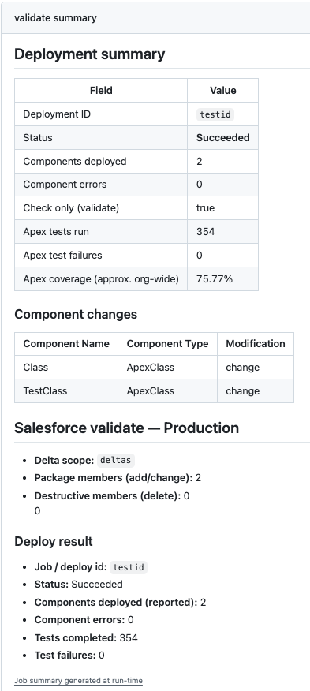

# SF Pipeline

Deploy salesforce metadata from a sandbox to production. This repo contains github actions that will validate and deploy changes from a pull request (PR).

## Features

- Validate changes by opening a PR
- Deploy changes by merging a PR
- Deployment summary
- PR comment with changed components, component errors, Apex test failures, and coverage warnings (updated in place on each run)
- Inline annotations on the PR's "Files changed" tab for failing components and test classes
- Delta deployments



## Install

Uses npm to install

```
npx shadcn@latest add jawills/sf-pipeline/delta-ci-setup
```

## PR comments and annotations

The validate and deploy workflows post a single comment on the PR (edited on each re-run, not duplicated) and emit inline `::error` / `::warning` annotations that point at the failing file and line. This needs `pull-requests: write`, which the workflows request. The default `GITHUB_TOKEN` is read-only on PRs from forks, so the comment step is `continue-on-error` and the annotations still appear there. GitHub shows at most 10 error annotations per step, so the full list is always in the comment.
